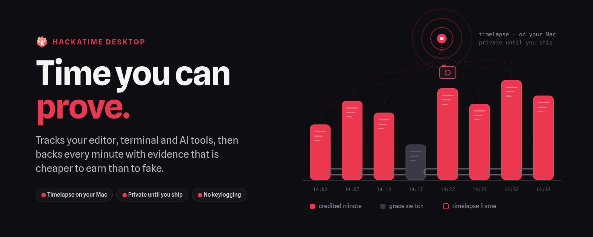

# Hackatime Desktop

A menu bar app that tracks your editor, terminal, browser and AI tools, and backs every minute with evidence the server can check. Faking it costs more than doing the work.

- **Passive tracking:** the focused window is classified on your Mac as project, research, unrelated or unknown. Titles and URLs never leave it.
- **AI tools:** hooks for Claude Code, Codex, Cursor and Amp send counts, tokens and line totals, never prompt text (`hooks/`).
- **Proof of time:** one signed, beacon-linked hash chain block per minute, plus salted Merkle roots of your working tree. The Secure Enclave signs when available, and App Attest is used on macOS 27+.
- **Screenshots, private until shipped:** off by default. When on, frames of allowlisted windows only, with secrets blacked out, encrypted on your Mac and destroyed after 30 days unless you ship them.
- **No** keylogging, camera, kernel driver, source upload while working, or required hardware.

The full protocol is in [PROTOCOL.md](PROTOCOL.md).

## Build (macOS 14+)

```sh
cd desktop/macos
swift test                 # protocol vectors shared with the server, chain, vault, classifier
./scripts/bundle.sh        # build/Hackatime Desktop.app (ad-hoc signed)
"build/Hackatime Desktop.app/Contents/MacOS/HackatimeDesktop" --self-test
```

For App Attest, sign with Developer ID: `SIGN_IDENTITY=… TEAM_ID=… PROFILE=…/profile.provisionprofile ./scripts/bundle.sh`, then notarise. The server needs `DESKTOP_APP_ATTEST_APP_ID=TEAMID.com.hackclub.hackatime.desktop`.

## Permissions

All optional. The app works with less information when one is missing; a missing permission never counts against you.

| Permission | Used for |
| --- | --- |
| Accessibility | window title and browser address, classified on device |
| Input Monitoring | input counts and where events came from (no key codes) |
| Screen Recording | only when screenshots are on |

## AI hooks

Put `hooks/hackatime-ai-hook` on your `PATH`, then:

- Claude Code: merge `hooks/claude-code-settings.json` into `~/.claude/settings.json`.
- Codex: `notify = ["hackatime-ai-hook", "codex"]` in `~/.codex/config.toml`.
- Amp: `amp plugins add hooks/amp-plugin.ts`.

## Privacy and young users

Screenshots need an explicit opt-in, which includes confirming a parent or guardian knows for under-18s. Pause, the vault folder and "Delete all local evidence" are in the menu. On hackatime.hackclub.com, Settings → Desktop lists devices, shipped evidence and an access log of every reviewer view. Account erasure removes all desktop data.
